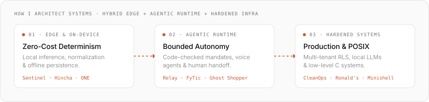
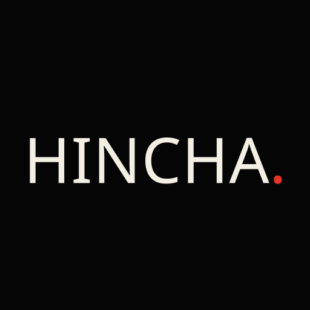
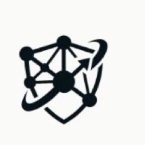
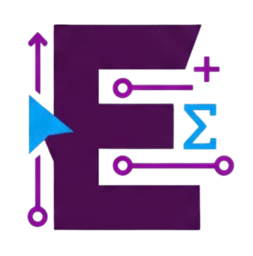

<a href="https://merid7.me" target="_blank">
  <picture>
    <source media="(prefers-color-scheme: dark)" srcset="assets/graphics/hero-dark.svg" />
    
  </picture>
</a>

 
 

<a href="https://merid7.me" target="_blank">
  <picture>
    <source media="(prefers-color-scheme: dark)" srcset="assets/icons/vercel-white.svg" />
    
  </picture>
</a>
&nbsp;&nbsp;&nbsp;&nbsp;
<a href="https://www.linkedin.com/in/luismeridadeleon/?skipRedirect=true" target="_blank">
  <picture>
    <source media="(prefers-color-scheme: dark)" srcset="assets/icons/linkedin-white.svg" />
    
  </picture>
</a>
&nbsp;&nbsp;&nbsp;&nbsp;
<a href="https://www.credly.com/users/luismeridadeleon/badges" target="_blank">
  <picture>
    <source media="(prefers-color-scheme: dark)" srcset="assets/icons/credly-white.svg" />
    
  </picture>
</a>
&nbsp;&nbsp;&nbsp;&nbsp;
<a href="mailto:luismerid7@gmail.com">
  <picture>
    <source media="(prefers-color-scheme: dark)" srcset="assets/icons/gmail-white.svg" />
    
  </picture>
</a>

 

Founder & CEO at **[Relay](https://merid7.me/work/projects/relay)** · AI Engineer at **FyTic** *(LegalTech agent orchestration)* · Computer Systems Engineering at **ESCOM-IPN**, Mexico City.

I build agentic systems with hard guardrails, on-device ML engines, multi-tenant products, and low-level POSIX software. Full case studies at **[merid7.me](https://merid7.me)**.

 

  <picture>
    <source media="(prefers-color-scheme: dark)" srcset="assets/graphics/architecture-dark.svg" />
    
  </picture>

 

### Selected Work

<table>
  <tr>
    <td width="38" align="center">
      <picture>
        <source media="(prefers-color-scheme: dark)" srcset="assets/marks/relay-white.svg" />
        
      </picture>
    </td>
    <td>
      <a href="https://merid7.me/work/projects/relay"><strong>Relay</strong></a> &nbsp;<code>2026</code> · <code>Founder & CEO</code> 
      Team of AI agents that operates your Mac &amp; browser with code-checked mandates, permission matrices, and human handoff.
    </td>
  </tr>
  <tr>
    <td width="38" align="center">
      
    </td>
    <td>
      <a href="https://merid7.me/work/projects/hincha"><strong>Hincha</strong></a> &nbsp;<code>2026</code> · <code>PWA · On-Device Audio ML</code> 
      Matchday AI companion with a personal Fan Graph and <em>Modo Sala</em> — YAMNet in TensorFlow.js separating room cheers from TV audio.
    </td>
  </tr>
  <tr>
    <td width="38" align="center">
      
    </td>
    <td>
      <a href="https://merid7.me/work/projects/sentinel"><strong>Sentinel SDK &amp; API</strong></a> &nbsp;<code>🏅 Top 5 · Hackathon 404</code> · <code>&lt;1ms SDK + LLaMA 70B</code> 
      Six-layer child-safety engine calibrated for Mexican organized-crime slang. 82.5% recall, 0% automatic false blocks.
    </td>
  </tr>
  <tr>
    <td width="38" align="center">
      <picture>
        <source media="(prefers-color-scheme: dark)" srcset="assets/marks/ghost-dark.svg" />
        
      </picture>
    </td>
    <td>
      <a href="https://merid7.me/work/projects/ghost-shopper"><strong>Ghost Shopper</strong></a> &nbsp;<code>🥉 3rd · LatAm GTM Hackathon</code> · <code>Voice AI</code> 
      Autonomous mystery-shopping agent that audits sales teams via ElevenLabs voice calls &amp; WhatsApp with real-time scoring.
    </td>
  </tr>
  <tr>
    <td width="38" align="center">
      
    </td>
    <td>
      <a href="https://merid7.me/work/projects/cleanops"><strong>CleanOps</strong></a> &nbsp;<code>2026</code> · <code>Multi-Tenant SaaS</code> 
      Field-operations SaaS for cleaning companies — GPS check-ins, client-compressed photo proof, contract quoting, and audited Postgres RLS.
    </td>
  </tr>
  <tr>
    <td width="38" align="center">
      <picture>
        <source media="(prefers-color-scheme: dark)" srcset="assets/marks/ronalds-dark.svg" />
        
      </picture>
    </td>
    <td>
      <a href="https://merid7.me/work/projects/ronalds-care"><strong>Ronald's Care</strong></a> &nbsp;<code>Talent Land · McDonald's</code> · <code>Local AI</code> 
      Traceable donor platform for Fundación Ronald McDonald with privacy-first thank-you generation via local Gemma 2B (Ollama).
    </td>
  </tr>
  <tr>
    <td width="38" align="center">
      
    </td>
    <td>
      <a href="https://merid7.me/work/projects/one"><strong>ONE</strong></a> &nbsp;<code>2025</code> · <code>Offline-First</code> 
      Life-management platform built solo in Vanilla JS + IndexedDB with async sync to Django REST &amp; PostgreSQL.
    </td>
  </tr>
  <tr>
    <td width="38" align="center">
      <picture>
        <source media="(prefers-color-scheme: dark)" srcset="assets/marks/minishell-dark.svg" />
        
      </picture>
    </td>
    <td>
      <a href="https://merid7.me/work/projects/minishell"><strong>Minishell</strong></a> &nbsp;<code>2025</code> · <code>C · POSIX</code> 
      Unix-like shell rebuilt from scratch in C — tokenization, <code>fork/exec/dup2/wait</code> pipelines, I/O redirections, heredocs, and signals.
    </td>
  </tr>
  <tr>
    <td width="38" align="center">
      
    </td>
    <td>
      <a href="https://merid7.me/work/projects/estudia-pro"><strong>Estudia-Pro</strong></a> &nbsp;<code>2025–2026</code> · <code>IPN EdTech</code> 
      Exam-oriented engineering mathematics platform with simulators, feedback exams, and multi-role dashboards.
    </td>
  </tr>
</table>

  <a href="https://merid7.me">Explore all case studies at <strong>merid7.me →</strong></a>

 

  <picture>
    <source media="(prefers-color-scheme: dark)" srcset="assets/graphics/stats-dark.svg" />
    
  </picture>

   
   

  <picture>
    <source media="(prefers-color-scheme: dark)" srcset="assets/graphics/activity-dark.svg" />
    
  </picture>

